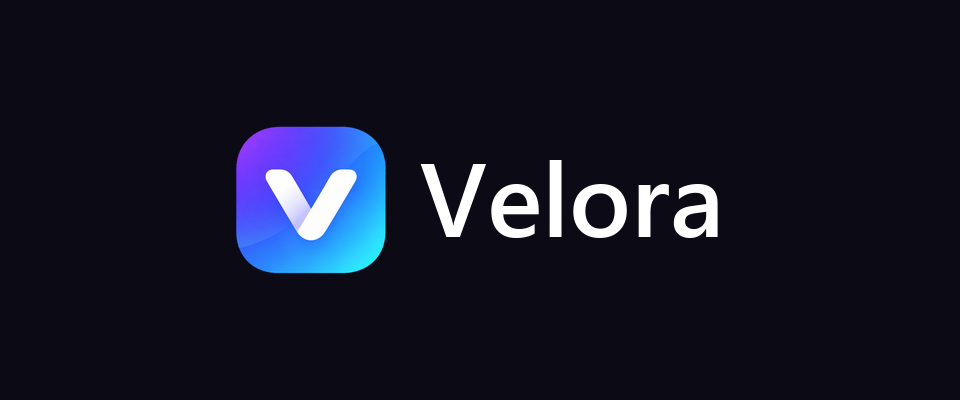
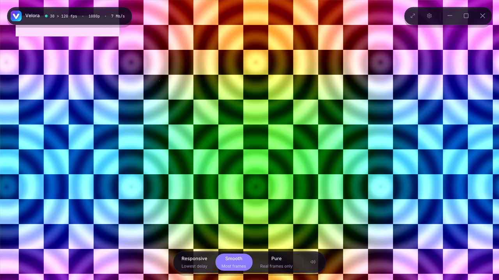
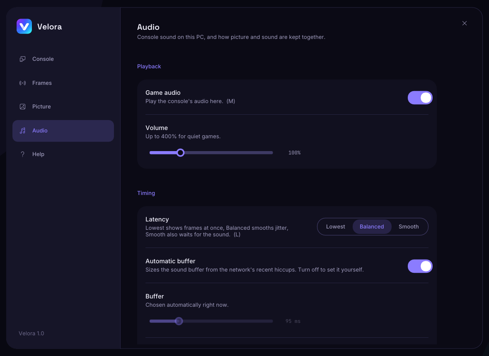
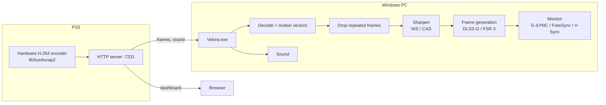

<div align="center">



**Your jailbroken PS5 on your Windows PC, smoother: frame generation, sharpening and variable refresh.**


-003791)

[](LICENSE.txt)

[Features](#features) ·
[Quick start](#quick-start) ·
[Usage](#usage) ·
[Your graphics card](#your-graphics-card) ·
[Firmware](#firmware-support) ·
[How it works](#how-it-works) ·
[Building](#building) ·
[Troubleshooting](#troubleshooting)

</div>

---

A small payload on the console drives the PS5's own H.264 encoder and serves
the picture and sound over the network. The Windows app shows it in a window
and makes it smoother than the console sends it: a 30 fps game becomes 60, 90
or 120 fps with frame generation, each frame is sharpened, and the monitor
follows the frames with G-SYNC or FreeSync. No capture card needed.

> [!IMPORTANT]
> Velora has been tested on **firmware 13.40** with an **NVIDIA RTX 3060**.
> It's built to run on every firmware from **3.20 to 13.60** (see
> [Firmware support](#firmware-support)), but only 13.40 has been tried on a
> console so far. The AMD and Intel paths (FSR 3, CAS) run, but have not been
> tried on AMD or Intel hardware yet. It's early: expect rough edges.

> [!WARNING]
> **Keep the PS5's HDMI connection steady while Velora runs.** Switching the
> monitor's input, the monitor going to sleep, or anything else that makes the
> PS5 renegotiate HDMI stops the console's encoder, and it only starts again
> after the PS5 restarts.
>
> - Stay on the PS5's input while streaming, or turn the monitor's sleep off.
> - An **HDMI EDID emulator** between the PS5 and the monitor makes the
>   connection look steady to the console whatever the monitor does.
> - Velora only captures in **60 Hz** mode. It turns 120 Hz Output off while it
>   runs and puts your setting back afterwards. Load it from the home screen,
>   before you start a game.

<p align="center">
   118 fps), the window buttons top right and the presets" width="100%">
</p>

## Features

**Smoother picture**

- **Frame generation.** NVIDIA **DLSS Frame Generation** up to 4X on RTX cards,
  with a target frame rate (your monitor's, or 60 to 240). **AMD FSR 3** frame
  generation (2X) on any DirectX 12 card. Picked from your card, switchable.
- **Real frames only.** A 30 fps game arrives as 60 fps with every frame twice.
  Velora finds the copies and drops them, so frame generation works from the
  real 30 and fills in the rest.
- **Motion from the console.** The PS5 encoder's own motion vectors guide the
  generated frames (raw, smoothed, or off).
- **Sharpening** before frame generation, so the frames in between are sharp
  too: **NVIDIA Image Scaling** or **AMD CAS**.
- **RTX Video Super Resolution** upscales the 1080p stream to your window.
- **Variable refresh.** A one-click **G-SYNC** profile just for Velora (other
  games untouched), FreeSync / Adaptive-Sync, or **V-Sync** for fixed-refresh
  monitors, with a warning when the frame rate doesn't divide the refresh rate.

**App**

- **Presets** at the bottom of the picture: **Responsive** (lowest delay),
  **Smooth** (most frames), **Pure** (real frames only). One click sets frame
  generation, latency and sharpening together.
- **Live numbers** in the top bar: real and shown frame rate, resolution and
  bitrate.
- **Edge-to-edge window**: no title bar, the picture fills the window; its own
  window buttons sit with the other controls.
- **Three latency modes**, sound with automatic sync, dark and light theme,
  full screen, controls that hide when you play.

**Payload (PS5)**

- Drives the console's hardware encoder; HTTP API on port **7231**.
- **Browser dashboard** at `http://<ps5-ip>:7231/`: live view, sound,
  screenshots and console recordings, nothing to install.
- **Seamless restarts.** A new Velora takes the capture over from the one
  running, without a console restart.

## Requirements

| | |
|---|---|
| **Console** | Jailbroken PS5 on firmware 3.20 to 13.60, with Payload Manager and an FTP server (tested on 13.40) |
| **PC** | Windows 10 or 11, 64-bit, with a DirectX 12 graphics card |
| **Network** | PC and PS5 on the same network. Wired is best; Wi-Fi works, with more jitter. |

## Quick start

### 1. Get the files

Everything is in the Velora folder. Keep the files together:

- `Velora.exe`, the Windows app, with its DLLs next to it
- `velora-payload.elf`, the PS5 payload

### 2. Run the payload

Upload the ELF to Payload Manager's folder on the console (FTP on port 2121
here; use your console's IP):

```bash
curl --ftp-create-dirs -T velora-payload.elf ftp://<ps5-ip>:2121/data/pldmgr/payloads/local/velora/Velora-1.0-ps5.elf
```

Then start **Velora** from Payload Manager on the console. You will see
*"Velora 1.0 loaded. Starting capture..."*, then *"Velora ready on port 7231"*.

> [!TIP]
> Payload Manager expects names shaped like `Name-version-ps5.elf`. If Glint
> is running, Velora takes the capture over from it.

### 3. Connect

Open `Velora.exe`, type the console's IP (for example `192.168.1.100`) and
press **Connect**. The address is saved and appears under recent consoles next
time.

> [!NOTE]
> Windows may say *"Windows protected your PC"* the first time, because the
> exe isn't signed. Click **More info → Run anyway**.

## Usage

Move the mouse to show the controls; they fade while you play.

- **Presets** (bottom): Responsive, Smooth, Pure. *Custom* appears when you
  change settings by hand.
- **Top bar** (top left): click it for the console settings.
- **Top right**: full screen, Settings, then minimize, maximize and close.
  There is no Windows title bar: drag the top of the window to move it,
  double-click there to maximize, drag the edges to resize.
- **Settings** (gear): Console, Frames, Picture, Audio, Help.

<p align="center">
  
</p>

For the smoothest picture: pick **Smooth**, set **Output target** to
**Monitor** (Settings → Frames), turn **G-SYNC** on (Settings → Picture →
Display) and go full screen.

### Keyboard shortcuts

| Key | Action | | Key | Action |
|---|---|---|---|---|
| `P` | Next preset | | `F11` | Full screen (or double-click) |
| `F` | Frame generation: Off, 2X, 3X, 4X | | `Esc` | Close settings, leave full screen |
| `V` | RTX Video Super Resolution | | `Ctrl+,` | Settings |
| `M` | Sound on/off | | `H` | Hide controls |
| `L` | Cycle latency mode | | `T` | Dark / light theme |
| `N` | Motion vectors: Encoder, Smoothed, Off | | | |

Settings and the log live in `%LOCALAPPDATA%\Velora`.

## Your graphics card

Velora picks the best path for your card at start. Every choice can be changed
in Settings.

| Card | Frame generation | Sharpening | Sync |
|---|---|---|---|
| **NVIDIA RTX 40 / 50** | DLSS-G, up to 4X | NIS | G-SYNC profile |
| **NVIDIA RTX 20 / 30** | DLSS-G, up to 4X, through the bundled `dlssg` mod files | NIS | G-SYNC profile |
| **NVIDIA GTX** | AMD FSR 3, 2X | CAS | V-Sync, or G-SYNC |
| **AMD Radeon** | AMD FSR 3, 2X | CAS | V-Sync, or FreeSync (Variable) |
| **Intel Arc / Iris** | AMD FSR 3, 2X | CAS | V-Sync, or Adaptive-Sync (Variable) |

> [!NOTE]
> On a fixed-refresh monitor with V-Sync, the shown frame rate should divide
> the refresh rate (60 fps on 60 or 120 Hz, not on 165 Hz). Velora warns you
> when it doesn't.

## Firmware support

The request that starts the PS5's video capture changes size and layout from
one firmware to the next. The payload reads the firmware version and builds
the request for it:

| Firmware | Layout |
|---|---|
| **13.00 – 13.60** | Glint's own, tested on 13.20, 13.40 and 13.60 |
| **3.20 – 12.70**, the 24 measured builds | Measured for that exact build |
| Other releases in a measured family (7.61, 12.02, …) | That family's layout |
| Any other release from 3.20 up (9.00, 11.00, …) | The nearest older measured one: a guess |
| Before 3.20 | Not supported |

The measured layouts come from [PBS Studio](https://github.com/seregonwar)
(`payload/src/fw_layouts`). Which one was used is written to
`/data/velora/capture.log` on the console (`OpenVideo layout: …`). If capture
fails on your firmware, that log is what helps.

## How it works



1. The payload starts the console's hardware encoder at 1080p60 and streams
   the frames and sound over plain HTTP.
2. The app decodes each frame on the CPU, which also gives it the encoder's
   motion vectors, and drops the frames a 30 fps game sends twice.
3. Each real frame is sharpened and, on NVIDIA, upscaled with RTX VSR, then
   handed to DLSS-G or FSR 3 with its motion vectors. They generate the frames
   in between and pace them to the monitor.

## Building

Velora is built from the Glint source tree, with the Glint FG engine and its
own brand and interface.

**Windows app** (MSYS2 MinGW 64-bit, as for Glint):

```bash
cd app
./build_deps.sh     # once: static FFmpeg + curl
./build_velora.sh   # app/build_velora/Velora.exe
```

It also needs, next to the source tree in `third_party/`: the NVIDIA
Streamline SDK (`streamline/`), the AMD FidelityFX SDK (`fidelityfx/`) and
NVAPI (`nvapi/`). The `dlssg` mod files are copied from `G:\dlssg` when present.

**PS5 payload** ([PS5 payload SDK](https://github.com/ps5-payload-dev/sdk), Linux or WSL):

```bash
cd payload/ps5
PS5_PAYLOAD_SDK=/path/to/ps5-payload-sdk make velora   # payload/build/velora-payload.elf
```

The logo lives in `app/res/velora_logo.png`. After changing it, remake
everything that shows it (exe icon, Discord asset, banners, the app's and the
dashboard's mark) and re-embed the payload's web assets:

```bash
python app/tools/make_velora_brand.py
powershell -File tools/make_velora_payload_assets.ps1
node tools/gen_blobs.js
```

`app/tools/cut_velora_logo.py` cuts a new artwork out of a flattened
checkerboard background.

## Troubleshooting

| Problem | Try |
|---|---|
| App can't connect | Check that the payload is running (its notification shows on the console) and that the PC and PS5 are on the same network. |
| Connects, but no picture (0 frames) | The PS5's HDMI connection changed while streaming (monitor input switch, sleep). Restart the PS5 and load Velora again. See the warning at the top. |
| "The PS5 refused to start video capture" | Velora retries on its own. If it keeps saying this, restart the PS5. |
| "The PS5 switched to 120 Hz output" | A game turned on 120 Hz. Set 120 Hz Output to **Off**, restart the PS5 and load Velora before starting the game. |
| Frame generation shows *Unavailable* | On an RTX 20 / 30 card, the `dlssg` files must stay next to `Velora.exe`. Otherwise switch the engine to **AMD FSR 3** (Settings → Frames) and restart. |
| G-SYNC says *Monitor off* | Turn G-SYNC on for the monitor in NVIDIA Control Panel → Set up G-SYNC (driver updates can switch it off). |
| Picture judders on V-Sync | Pick a frame count whose rate divides the refresh rate, or set the monitor to 60 / 120 Hz. |
| Picture stutters on Wi-Fi | Switch latency to **Balanced** (`L`), or use a cable. |
| Smeared or frozen picture | Settings → Console → **Request keyframe**. |

## License

Velora is licensed under the [GNU General Public License v3.0](LICENSE.txt).
It is built on [Glint](https://github.com/MiladRTX/Glint) (GPL-3.0), and its
source code must be available to everyone it's given to. Third-party parts
keep their own licenses; see [NOTICE.txt](NOTICE.txt): Dear ImGui (MIT), Inter,
Space Grotesk and JetBrains Mono (SIL OFL 1.1), FFmpeg built with x264 (GPL),
AMD FidelityFX SDK (MIT), NVAPI (MIT), NVIDIA Streamline and DLSS (NVIDIA's
license), and the `dlssg` files (MIT, with NVIDIA's runtime inside).

## Disclaimer

Velora is a homebrew project for consoles you own. It is not affiliated with
or endorsed by Sony Interactive Entertainment, NVIDIA or AMD. "PlayStation"
and "PS5" are trademarks of Sony Interactive Entertainment Inc. NVIDIA, DLSS
and G-SYNC are trademarks of NVIDIA Corporation. AMD, FSR and FreeSync are
trademarks of Advanced Micro Devices, Inc.

## Credits

- [Glint](https://github.com/MiladRTX/Glint) by MiladRTX: the payload, the
  streaming protocol and the app Velora is built on.
- [PBS Studio](https://github.com/seregonwar) by seregonwar: the PS5 capture
  approach Glint learned from, and the capture layouts for firmwares 3.20 to
  13.60 (GPL-3.0-or-later).
- `dlssg` by sdli1995: DLSS Frame Generation on RTX 20 / 30.
- Built with [Dear ImGui](https://github.com/ocornut/imgui),
  [FFmpeg](https://ffmpeg.org/), [x264](https://www.videolan.org/developers/x264.html),
  [curl](https://curl.se/), [SDL2](https://www.libsdl.org/),
  [NVIDIA Streamline](https://github.com/NVIDIA-RTX/Streamline),
  [AMD FidelityFX SDK](https://github.com/GPUOpen-LibrariesAndSDKs/FidelityFX-SDK),
  [NVAPI](https://github.com/NVIDIA/nvapi) and the
  [PS5 payload SDK](https://github.com/ps5-payload-dev/sdk).
